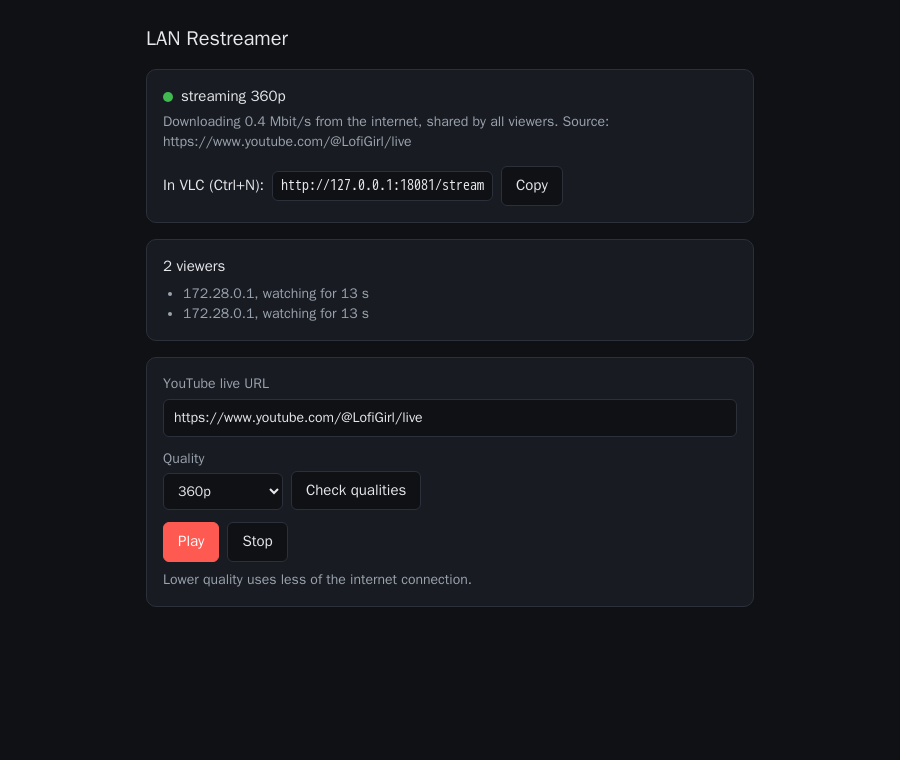

# YouTube LAN restreamer

Watch one YouTube live stream on several PCs while downloading it **only once**.

One PC or server pulls the stream from YouTube; every other PC on the LAN
opens it in **VLC**. Viewers just receive a copy of the same video bytes.

```
YouTube ──(1× bandwidth, throttled link)──> restreamer ──LAN──> VLC on PC 2
                                                       ├─LAN──> VLC on PC 3
                                                       └─LAN──> VLC on PC 4 …
```

There are two ways to run it:

* **On a desktop PC:** double-click a start script, answer two questions.
* **On a headless server:** `docker compose up -d`, then control it from a browser.

## Option A: desktop PC

You need Python 3.10+ (https://www.python.org/downloads/, tick *Add python.exe
to PATH*) **or** [uv](https://docs.astral.sh/uv/). The first run installs
[streamlink](https://streamlink.github.io/) automatically, so it needs internet.

* **Windows:** double-click `start-windows.bat`
* **Linux / macOS:** run `./start-linux-mac.sh`

It asks for the URL and a quality, then prints the addresses:

```
YouTube live URL: https://www.youtube.com/@SomeChannel/live
Available qualities: 144p, 240p, 360p, 480p, 720p, 1080p, worst, best
Quality [best]: 720p

================================================================
 Restreaming: https://www.youtube.com/@SomeChannel/live
 In VLC on the other PCs: Media > Open Network Stream, enter:
     http://192.168.1.59:8080/stream
 Control page (change stream / quality) in a browser:
     http://192.168.1.59:8080/
 Press Ctrl+C to stop.
================================================================
```

In this mode it downloads for as long as it runs, so the first viewer gets a
picture instantly. Close it (Ctrl+C) when you're done.

Windows may ask to allow Python through the firewall. Click **Allow** (private
networks), or the other PCs can't connect.

You can skip the questions with arguments:

```
start-windows.bat https://www.youtube.com/@SomeChannel/live --quality 720p --port 8080
python restream.py <url> -q 720p,480p,best        # comma list = fallbacks
python restream.py --help                         # all options
```

## Option B: headless server (Docker)

```
cp .env.example .env      # optional: set URL, QUALITY, PORT, ...
docker compose up -d
```

Then open **`http://<server>:8080/`** in a browser, on a laptop or phone:

* paste a YouTube link, press **Check qualities**, pick one, press **Play**
* see whether it's streaming, how many Mbit/s it uses, and who's watching
* **Stop** stops downloading entirely



How it behaves:

* **It only downloads while someone is watching.** The download starts when the
  first VLC connects (the picture appears after ~3–5 s) and stops 30 s after
  the last one disconnects (`IDLE_TIMEOUT`). An always-on server wastes nothing
  when nobody is looking. Set `ON_DEMAND=0` to download continuously instead.
* `URL` / `QUALITY` in `.env` set what plays after a (re)start. Changes made on
  the control page last until the container restarts. Leave `URL` empty to
  always pick on the page.
* Logs: `docker compose logs -f`. Stop: `docker compose down`.
* YouTube changes often. If streams stop working, update streamlink:
  `docker compose build --pull --no-cache && docker compose up -d`.

All settings (see `.env.example`):

| Variable       | Default | Meaning                                                        |
|----------------|---------|----------------------------------------------------------------|
| `URL`          | (empty) | stream to start with; empty = choose on the control page       |
| `QUALITY`      | `best`  | `720p`, `480p`, … or a fallback list like `720p,480p,best`     |
| `PORT`         | `8080`  | port on the server for VLC and the control page                |
| `ON_DEMAND`    | `1`     | `1` = only download while watched, `0` = always                |
| `IDLE_TIMEOUT` | `30`    | seconds to keep downloading after the last viewer leaves       |
| `ADVERTISE`    | (empty) | server address to print in the logs, e.g. `192.168.1.10`       |
| `TZ`           | `Europe/Brussels` | timezone of the log timestamps                       |

The same variables also work without Docker (`ON_DEMAND=1 python restream.py`),
and `--on-demand` / `--idle-timeout` exist as command-line flags.

## Viewer PCs

VLC → **Media → Open Network Stream** (Ctrl+N) → enter the address, e.g.
`http://192.168.1.59:8080/stream` → **Play**.

From a terminal: `vlc http://192.168.1.59:8080/stream`

The control page shows this address with a copy button. The restreaming PC can
watch too: `http://localhost:8080/stream` uses no extra bandwidth.

## Good to know

* **Pick the lowest quality that looks OK.** Each step down saves throttled
  bandwidth.
* Switching stream or quality on the control page keeps VLC viewers connected.
  They see a short hiccup and then the new stream.
* If the internet hiccups or YouTube rotates its URLs, it reconnects on its own.
  VLC keeps playing after a short pause.
* A viewer who joins late starts at the latest segment and gets a picture
  right away.
* A viewer that stops reading (paused for minutes, broken Wi-Fi) is disconnected
  so it can't slow down the others. Press Play again in VLC.
* Anyone on the LAN can open the control page. There is no password, so don't
  expose the port to the internet.
* Works with anything streamlink supports (Twitch, …), not only YouTube.
  YouTube *live* streams are the main target; plain uploaded videos may not work.
* Stuttering on every viewer at once means the throttled link is too slow for
  the chosen quality, so pick a lower one. Stuttering on one viewer only: in VLC
  raise *Tools → Preferences → All → Input/Codecs → Network caching* (e.g. to
  3000 ms).
* Older instructions used `http://<pc>:8080/` without `/stream`. That still works
  in VLC; browsers get the control page there instead.

## Why not an existing tool?

The free tools I looked at all fall short of "one download, many VLC viewers,
zero config":

* `streamlink --player-external-http` serves only one client at a time and
  re-downloads the stream for every new client.
* liveproxy starts a separate yt-dlp/streamlink download per viewer.
* VLC `--sout` or MediaMTX + ffmpeg + yt-dlp can do it, but they take a hand-built
  command or config file, and VLC's own YouTube support breaks often.

This tool is a single Python file on top of streamlink.
